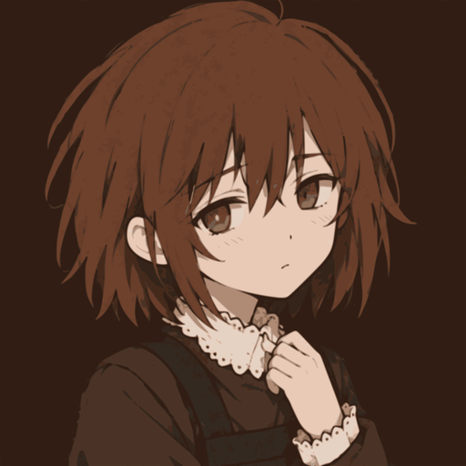

# Asya

> *Ася*

| | |
|---|---|
| **Full name** | Asya Shubina (Ася Шубина) |
| **Gender** | Female |
| **Age** | 14 |
| **Status** | Deceased |
| **Occupation** | Student |
| **Hair** | Short, messy brown, bangs to just below ear length |
| **Eyes** | Deep gold, yellow pupils |
| **Wears** | School uniform, black apron, Komsomol pin |
| **Role** | The protagonist |

**Asya** is the protagonist of Ferry/nopanamaman's visual novel, *Z.A.T.O // I Love the World and Everything
In It*.

## Appearance

Asya has short, messy brown hair, with bangs that reach just below ear length. Her eyes are a deep gold
colour with yellow pupils.

Every sprite has her in the female school uniform: a long, dark brown dress with long sleeves and a white
lace collar, trim and cuffs. Over the dress she wears a black apron with a large pocket, and a small pin
on her right side, presumed to be a Komsomol pin.

## Background

Asya was raised in the city of Vorkuta-5, a closed city known as a Z.A.T.O., where she lives and attends
school.

## Personality

Asya is a quiet girl who is seen as an outcast in her class. At the beginning she struggles to form
sentences without trailing off or stuttering, which shows when Vadim talks and makes fun of her, and
again when she first talks to Marina and Ira. Through the events of Z.A.T.O she becomes more confident
talking to Marina, and eventually to Vadim.

She has a complex view on life. She has deep insecurities, believing herself unworthy of love, yet is
selfless and kind, asserting that she loves the universe: "The universe is too kind to an ungrateful brat
like me." As an enduring mechanism she turns suffering into enjoyment, often thinking that things could
have been far worse.

She can sometimes spiral out of control: at the hint of abandonment she becomes scared and even sad. She
is, paradoxically, strong willed in any non-social situation -- even in the face of a concept like
nihilism she does not seem phased. She has an excellent understanding of philosophy, and is at the same
time deeply involved in her strange fantasies, to the point of convincing herself that reading a fairy
tale book was extraordinary enlightening.

## Relationships

### Ira Grachevskaya

Ira has multiple times bailed Asya out from bullying and from being picked on, most notably when she threw
a chair at Vadim. Asya has a complicated appreciation of Ira, preferring to see her as a friend but
understanding how their friendship is mostly one sided. Ira plays a central role in Asya's life from the
start of the plot to near the end.

### Vadim Garin

Vadim is the main source of torment to Asya, effectively leading her classmates to engage in various cruel
pranks which Asya endures. He frequently copies Asya's homework. They have at one point hung out, along
with Marina, which had no effect on his treatment of her for the rest of the plot.

### Marina Kaplan

Marina is a friend of Asya, met at first to discuss the disappearance of Ira, slowly building a friendship
together. Marina is responsible for revealing to Asya how she has been keeping the ill Ira in her
apartment.

### Tosya

It is not clear whether Tosya is a result of the illness, a manifestation of Asya's willpower, or a real
human being. She is the close friend of Asya, until sometime before the beginning of the plot, when Tosya
disappears from Asya's life until her eventual return later in the story.

### Lev Kaplan

Lev is the brother and caretaker of Marina. Lev reveals to Asya the nature of the disease, and conducts a
test to evaluate her. He is the one who hands her the pills capable of suppressing the illness, which she
declines to take but attempts to gift to her parents.

## Trivia

* Ferry has drawn a gender bent version of Asya, along with the rest of the major cast, in the sketchbook
  portion of the gallery accessible from in-game.
* Asya enjoys reading children's books despite her age.
* Based on the context of her location and the pin on her uniform, Asya is part of the Komsomol, the youth
  branch of the communist party of the Soviet Union.
* She is hinted to be the source of the signal detected around Vorkuta-5 at the end of the game, with her
  message "I love you" written in Russian Morse code being detectable in regions around the city.
* She likes the drink Duchess.

## This repository

<div align="center">
  

  <p>
    <a href="https://github.com/Grachevskaya/asya" style="text-decoration:none">
      
    </a>
    <a href="https://github.com/Grachevskaya/asya/releases/latest" style="text-decoration:none">
      
    </a>
    <a href="https://choosealicense.com/licenses/agpl-3.0/" style="text-decoration:none">
      
    </a>
  </p>
</div>

**asya** is a package-name filter.

## About this module

Although it's bad practice to detect the installation of specific apps, not every app using root provides random package name support. In this case, if apps related to root (such as Fake Location and Storage Isolation) are detected, it is tantamount to detecting that the device is rooted.

Additionally, some apps use various loopholes to acquire your app list, in order to use it as fingerprinting data or for other nefarious purposes.

This module can work as an Zygisk module to hide apps or reject app list requests.

Some apps use syscalls to check a running uid and, when that query fails, take it as a sign that an unknown app is being hidden; [tosya](https://github.com/Grachevskaya/tosya) is what disguises it.

### Building

```sh
./gradlew :app:assemble :zygote:assemble
```

[CREDITS.md](CREDITS.md) · [LICENSE.md](LICENSE.md) -- AGPL-3.0

----

[中文（简体）](README_zh_CN.md) · **English**
